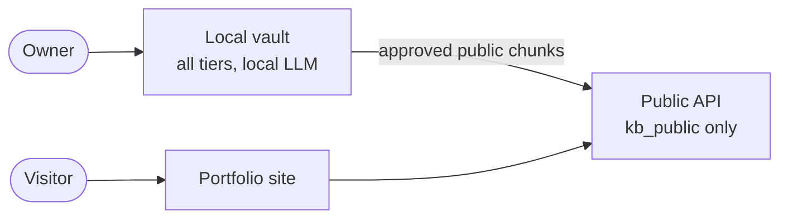

# ai-twin

A personal knowledge base and AI twin. One FastAPI + LangGraph service with two faces:

- **Owner mode** (local vault): ingest notes, files, links and repos; ask anything across every data tier; add
  and change data in plain language, with a confirmation before every write.
- **Public mode** (portfolio assistant): answers only from approved public facts, serves the resume and
  forwards opportunities by email.

Private data never leaves the local vault; the public deployment only ever holds published public chunks.

## Quick start

Prerequisites: [uv](https://docs.astral.sh/uv/) and Docker or Podman with a compose provider.

| | macOS / Linux | Windows (PowerShell 7) |
|---|---|---|
| Check the machine | `make doctor` | `./scripts/dev.ps1 doctor` |
| First-time setup (`.env`, deps, hooks, stack) | `make setup` | `./scripts/dev.ps1 setup` |
| Run the API | `make run` | `./scripts/dev.ps1 run` |
| Stack status / logs | `make status` / `make logs` | `./scripts/dev.ps1 status` / `logs` |
| Quality gate | `make check` | `./scripts/dev.ps1 check` |
| Local LLM (native Ollama: install, start, pull, smoke) | `make ollama ARGS="start"` | `./scripts/dev.ps1 ollama start` |
| MongoDB data migrations (they also run at every API start) | `make migrate-status` / `make upgrade` / `make downgrade ARGS="0003 --apply"` | `./scripts/dev.ps1 migrate status` / `migrate upgrade` / `migrate downgrade 0003 --apply` |
| Admin API keys | `make keys ARGS="create owner --scope admin"` | `./scripts/dev.ps1 keys create owner --scope admin` |
| Ask the vault in the terminal | `make chat` | `./scripts/dev.ps1 chat` |
| Add knowledge in plain language | `make twin` | `./scripts/dev.ps1 twin` |
| Encrypted vault export | `make export` | `./scripts/dev.ps1 export` |
| Vault import (dry run; add `--apply`) | `make import ARGS="vault/exports/X.atv"` | `./scripts/dev.ps1 import vault/exports/X.atv` |
| Remove containers, data, caches | `make cleanup ARGS="--apply"` | `./scripts/dev.ps1 cleanup --apply` |

Then open http://127.0.0.1:8000/docs. `GET /healthz` is liveness; `GET /readyz` checks MongoDB, Redis (Valkey)
and Qdrant, and reports how many models each role can use (informational). Model providers are
configured in `.env` and `config/models.yaml`; a provider with no key is simply disabled.
Admin routes (`/admin/v1/...`, `X-API-Key`) exist only with `DEPLOYMENT_PROFILE=vault`; the `public` profile
serves `/v1/...` and health only.

Destructive scripts are dry runs unless given `--apply`. Real notes, documents and secrets live in the
git-ignored `vault/` and `.env`; tests and seeds use a fake persona only.

## Docs

| Read | For |
|---|---|
| [`docs/hld.md`](docs/hld.md) | Purpose, principles, topology, data tiers, storage, request identity |
| [`docs/components.md`](docs/components.md) | Module map, runtime wiring, what LangChain does and where custom code takes over |
| [`docs/flows/public-flow.md`](docs/flows/public-flow.md) | Visitor chat graph, guards, opportunity capture |
| [`docs/flows/owner-flow.md`](docs/flows/owner-flow.md) | Owner graph and the intake assistant with its confirmations |
| [`docs/super-agent.md`](docs/super-agent.md) | The super agent: plan, delegate to intake/ask/prep, compose; per-agent models |
| [`docs/rag-pipeline.md`](docs/rag-pipeline.md) | Ingestion, review and publish, hybrid retrieval, context building |
| [`docs/threat-model.md`](docs/threat-model.md) | Tiers, trust boundaries, guards, id and error-envelope policy |
| [`packages/llm-orchestrator/README.md`](packages/llm-orchestrator/README.md) | Model inventory, roles, tier policy, fallbacks, overrides, hooks |
| [`specs/`](specs/) | One folder per feature: `spec.md`, `plan.md`, `tasks.md` |

Every diagram in the docs is Mermaid, so GitHub renders it and diffs stay readable.

## Stack

FastAPI · LangGraph · LangChain · Langfuse · MongoDB · Valkey/Redis · Qdrant · structlog · OpenTelemetry · uv
