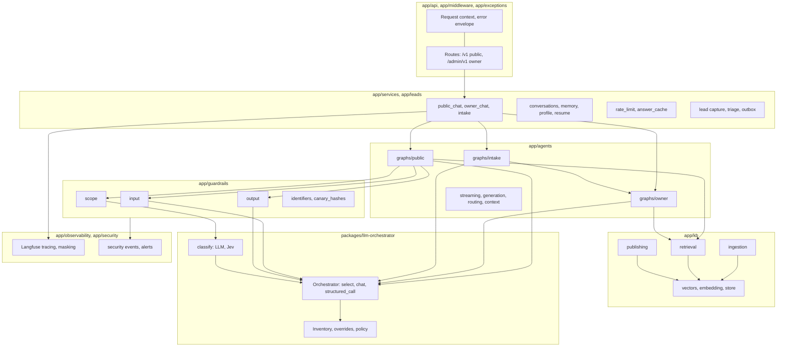
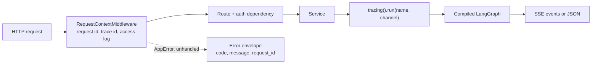
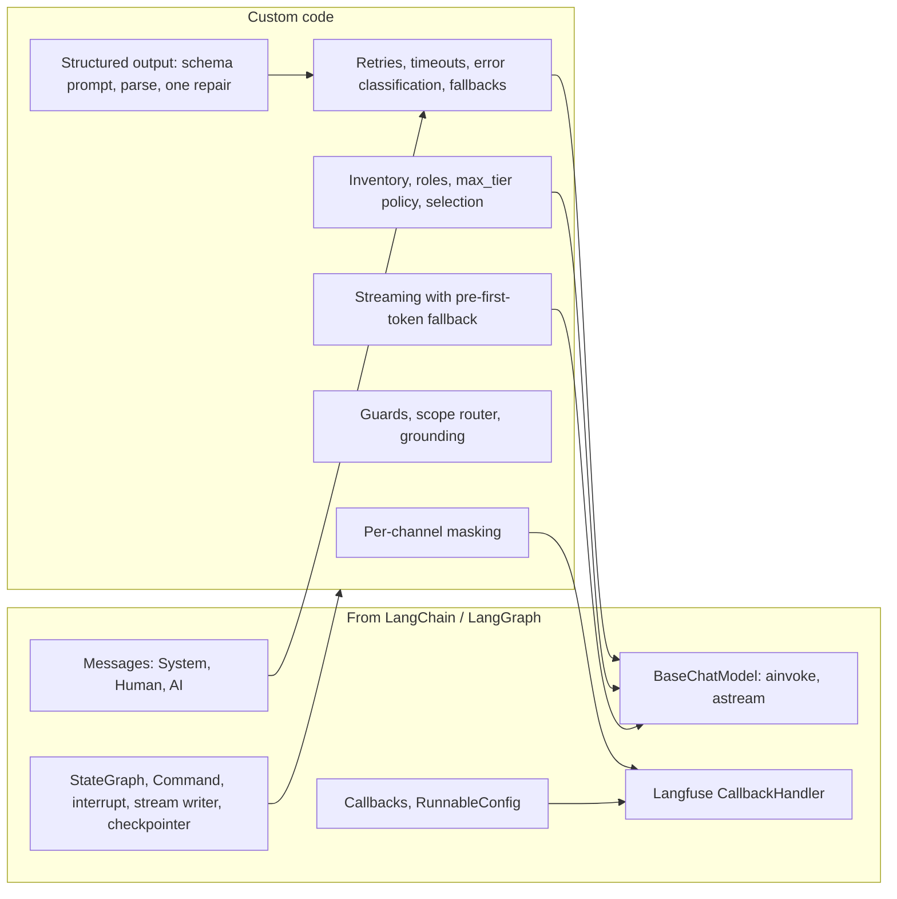
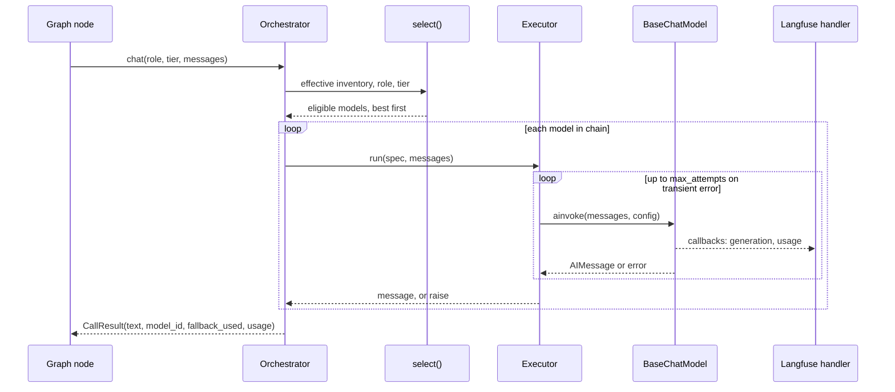

# Components

How the code is split, what each part owns and where LangChain ends and custom code begins. For the system
view see [`hld.md`](hld.md); for the request paths see [`flows/public-flow.md`](flows/public-flow.md),
[`flows/owner-flow.md`](flows/owner-flow.md) and [`rag-pipeline.md`](rag-pipeline.md).

## Component map

## Modules

| Module | Owns |
|---|---|
| `app/core` | Settings (pydantic-settings), logging, telemetry, request-scoped context |
| `app/api`, `app/middleware`, `app/exceptions` | Routes, request/trace ids, the single error envelope and its codes |
| `app/auth` | API keys (hashed, scoped) and visitor identity (salted hash of the forwarded address) |
| `app/agents` | The three graphs, the router decision schema and keyword fallback, token streaming with pre-first-token fallback, owner context blocks |
| `app/agents/intake` | The intake assistant's action catalogue, draft grounding and validation, confirmation reply classifier, suggestions |
| `app/guardrails` | Input guard, scope router, output guard, identifier recognisers, canary hashes |
| `app/kb/ingestion` | Parsers, chunking, redaction, employer guard, labelling, job pool with restart recovery |
| `app/kb/retrieval` | Hybrid retriever, local cross-encoder rerank, budgeted context builder |
| `app/kb/publishing.py` | Review actions; the only writer of `kb_public` |
| `app/leads` | Opportunity capture (public graph nodes), lead storage, triage, email outbox, Turnstile |
| `app/services` | Chat services (SSE), conversations, memory, profile facts, resume, rate limits, answer cache, audit |
| `app/observability` | Langfuse facade, per-channel masking, metrics |
| `app/security` | Security events and debounced email alerts |
| `app/db`, `app/storage`, `app/vector`, `app/cache` | MongoDB documents, encrypted blob store, Qdrant client, Redis/Valkey |
| `packages/llm-orchestrator` | Provider-neutral model inventory and tier-safe calling; see its [README](../packages/llm-orchestrator/README.md) |

## Runtime wiring

Graphs are built once with their dependencies (`PublicDeps`, `OwnerDeps`, `IntakeDeps`) as frozen dataclasses.
Nodes are methods on a `*Nodes` class; routing between nodes is a pure function of state (`_after_*`) or a
`Command(goto=...)` returned by the node.

## LangChain and LangGraph in this project

The project uses LangChain's building blocks and keeps control of everything that decides policy. The
boundary is deliberate: policy (who may see what) must be testable code, not framework configuration.

| Topic | What the project does |
|---|---|
| **Model construction** | `llm_orchestrator/providers.py` builds a provider class per `ModelSpec` (`ChatGroq`, `ChatCerebras`, `ChatGoogleGenerativeAI`, `ChatOpenAI` for OpenRouter, `ChatOllama`, or an offline mock), importing each integration only when used. `init_chat_model` is **not** used: the inventory is the single place that names providers, a missing key must mean "disabled" rather than an import-time error, and provider SDK retries must be switched off (`max_retries=0`) so the executor can count and classify attempts. |
| **Fallbacks** | LangChain's `with_fallbacks` is **not** used. The orchestrator walks the eligible chain for a role itself (`Orchestrator.chat`), so a fallback can only land on a model that passed the tier check, and each attempt is recorded. Streaming does its own fallback in `app/agents/streaming.py`: a model that fails or stalls before its first token is skipped; after the first token the answer is kept and marked incomplete rather than splicing two models. |
| **Retries** | `tenacity` inside the executor: transient errors (timeouts, 408/409/425/429, 5xx, connection errors) retry with jittered exponential backoff up to `max_attempts`; other 4xx are permanent. |
| **Structured output** | `with_structured_output` is **not** used, because small local models and free-tier models do not all support tool calling. `Orchestrator.structured_call` prepends the JSON Schema of a pydantic model, parses the reply (tolerating code fences), and on invalid output sends one repair message to the same model before moving to the next. Used by the owner router, intake extraction, confirmation classifier, scope classifier, grounding judge and lead extraction. |
| **Messages** | Prompts are lists of `SystemMessage`, `HumanMessage` and `AIMessage`. Graphs build them; the orchestrator only forwards them. History is filtered by tier before it becomes messages. |
| **Callbacks and tracing** | Every call passes `RunnableConfig` with callbacks and metadata (`llm_role`, `llm_tier`, `llm_model`, `ls_model_name`). `app/observability/tracing.py` registers a LangChain configure hook that installs the Langfuse `CallbackHandler` for the duration of a run, so graph nodes and model calls are traced without passing callbacks by hand. The Langfuse trace id equals the request trace id. Masking is applied in the Langfuse client by channel. |
| **LangGraph** | `StateGraph` with `TypedDict` state. Conditional edges for routing, `Command(goto=...)` in the intake and lead-capture nodes, `interrupt` for confirmations, `get_stream_writer` for owner tokens, and a MongoDB checkpointer (`app/agents/checkpoint.py`) so a pending confirmation survives a restart. |
| **Where custom code takes over** | Tier policy and model selection; retries and fallbacks; structured-output repair; streaming fallback; every guard; context budgeting and tier tracking; retrieval and reranking; masking; the hooks that feed metrics and alerts. LangChain never sees a model that policy has not already approved. |

### One model call, end to end

## Hooks, metrics and events

- `llm_orchestrator.hooks.on_attempt` and `on_exhausted` feed Prometheus counters and the "all models failed"
  alert; listeners receive names and numbers, never text.
- Guard decisions and scope intents are counted (`GUARD_DECISIONS`, `SCOPE_INTENTS`).
- Guards and auth failures write security events (rule names only), which the alert worker emails with
  debouncing.
