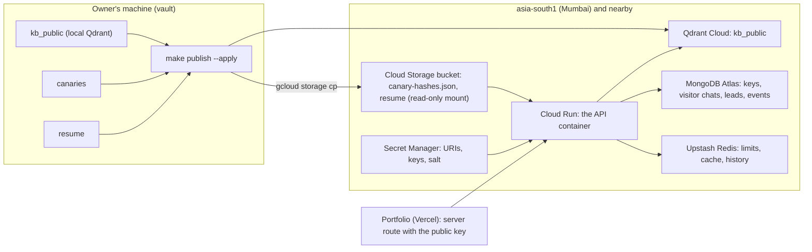

# Deploying the public assistant

The public deployment serves published knowledge only, with no admin routes at all
(`DEPLOYMENT_PROFILE=public`). The vault stays on the owner's machine.



## Why Cloud Run

- **Not Vercel.** Its Python functions cannot hold this app: the embedding and reranking models exceed their
  size limits.
- **Not Hugging Face Spaces.** Spaces allow outbound connections only on ports 80, 443 and 8080. MongoDB Atlas
  (27017) and Redis (6379) are unreachable from a Space.
- **Cloud Run** runs the same container, has no port limits, sits in `asia-south1` next to Upstash (Mumbai) and
  Atlas, scales to zero, and its free tier covers a portfolio's traffic.
  - **Cold starts.** The first request after an idle period waits a few seconds while the models load. Set
    `--min-instances 1` if that matters more than cost.
- **Same image elsewhere.** The image runs unchanged on Fly.io (`bom`) or Render.

## On the public profile

| | Vault | Public |
|---|---|---|
| Admin routes | mounted | not mounted (404) |
| Qdrant collections | `kb_public`, `kb_private`, `kb_confidential` | `kb_public` only |
| Retrieval filter | checks `kb_documents` in MongoDB | trusts `kb_public` (only published chunks are there) |
| Canary hashes | read from `canaries` | read from `PUBLIC_CANARY_HASHES_PATH` (hashes only) |
| Resume | decrypted from the vault | `PUBLIC_RESUME_PATH` |

## One-time setup (owner)

### 1. Data services
- **MongoDB Atlas.**
  - Create a database user for the app with `readWrite` on `ai_twin` only, not the root user.
  - Under Network Access, allow `0.0.0.0/0`. Cloud Run has no fixed outbound IP without a paid VPC connector
    and Cloud NAT, so access is protected by that user's long random password.
- **Upstash Redis.** Use the TCP connection URL (`rediss://default:<password>@<host>.upstash.io:6379`). The REST
  URL and tokens are not used.
- **Qdrant Cloud.** Create a free cluster as close to Mumbai as the free tier allows: an Asia region on GCP if
  offered, otherwise AWS Europe (Frankfurt, `eu-central-1`, about 110–130 ms from Mumbai; North America is
  about 200 ms). Note its URL (`https://<id>.<region>.cloud.qdrant.io:6333`) and an API key. Free clusters are
  suspended after a week without use.

### Where the cloud values live in the vault's `.env`

The local stack owns `MONGODB_URI`, `REDIS_URL`, `QDRANT_URL` and `QDRANT_API_KEY`. A cloud value under one of
those names would point the vault at the cloud and send private data there, so cloud values get their own
names (`.env.example` lists them):

| Name | What | Read by |
|---|---|---|
| `PUBLISH_QDRANT_URL`, `PUBLISH_QDRANT_API_KEY` | the Qdrant Cloud cluster (`https://…:6333`) | `make publish` |
| `ATLAS_MONGODB_URI` (+ `ATLAS_MONGO_USERNAME`, `ATLAS_MONGO_PASSWORD`) | the Atlas app user's URI | the deploy steps, the portfolio key |
| `UPSTASH_REDIS_URL` | the Upstash TCP URL (`rediss://…:6379`) | the deploy steps |
| `UPSTASH_TOKEN`, `UPSTASH_READONLY_TOKEN` | Upstash REST tokens | nothing (kept for reference) |

### 2. Google Cloud
Install the [gcloud CLI](https://cloud.google.com/sdk/docs/install). Then, with your project:

```bash
gcloud config set project <PROJECT_ID>
gcloud config set run/region asia-south1
gcloud services enable run.googleapis.com cloudbuild.googleapis.com artifactregistry.googleapis.com secretmanager.googleapis.com storage.googleapis.com
```

**Secrets.** Each value is piped from `.env` by name into Secret Manager, so it never appears on screen or in
the shell history:

```bash
envval() { grep "^$1=" .env | head -1 | cut -d= -f2- | sed -E 's/^"(.*)"$/\1/' | tr -d '\n'; }
envval ATLAS_MONGODB_URI      | gcloud secrets create ai-twin-mongodb-uri --data-file=-
envval UPSTASH_REDIS_URL      | gcloud secrets create ai-twin-redis-url --data-file=-
envval PUBLISH_QDRANT_API_KEY | gcloud secrets create ai-twin-qdrant-api-key --data-file=-
envval GEMINI_API_KEY         | gcloud secrets create ai-twin-gemini-api-key --data-file=-
openssl rand -hex 32 | tr -d '\n' | gcloud secrets create ai-twin-visitor-salt --data-file=-
```

To change one later: `envval NAME | gcloud secrets versions add <secret> --data-file=-`.

Add any other public-tier provider keys, `TURNSTILE_SECRET_KEY` and the SMTP password the same way.

**Bucket for the published files** (private, in Mumbai):

```bash
gcloud storage buckets create gs://<BUCKET> --location=asia-south1 --uniform-bucket-level-access
```

**Service identity.** Let the service read the secrets and the bucket:

```bash
SA="$(gcloud projects describe <PROJECT_ID> --format='value(projectNumber)')-compute@developer.gserviceaccount.com"
gcloud projects add-iam-policy-binding <PROJECT_ID> --member="serviceAccount:$SA" --role=roles/secretmanager.secretAccessor
gcloud storage buckets add-iam-policy-binding gs://<BUCKET> --member="serviceAccount:$SA" --role=roles/storage.objectViewer
```

## Every publish

```bash
make publish                         # dry run: counts only
make publish ARGS="--apply"          # mirror kb_public to Qdrant Cloud, write vault/publish/*
gcloud storage cp vault/publish/* gs://<BUCKET>/
```

The canary file is re-read whenever it changes, so no redeploy is needed.

## Deploy

From the repository root. `.gcloudignore` uploads only code and config; vault, `.env` and notes never leave
the machine.

```bash
gcloud run deploy ai-twin-public --source . --region asia-south1 \
  --allow-unauthenticated --execution-environment gen2 \
  --memory 2Gi --cpu 1 --min-instances 0 --max-instances 2 --concurrency 20 --timeout 300 \
  --set-env-vars "MONGODB_DATABASE=ai_twin,QDRANT_URL=$(envval PUBLISH_QDRANT_URL),PUBLIC_OWNER_NAME=<your name>,PUBLIC_CANARY_HASHES_PATH=/publish/canary-hashes.json,PUBLIC_RESUME_PATH=/publish/<resume file>" \
  --set-secrets "MONGODB_URI=ai-twin-mongodb-uri:latest,REDIS_URL=ai-twin-redis-url:latest,QDRANT_API_KEY=ai-twin-qdrant-api-key:latest,VISITOR_HASH_SALT=ai-twin-visitor-salt:latest,GEMINI_API_KEY=ai-twin-gemini-api-key:latest" \
  --add-volume name=publish,type=cloud-storage,bucket=<BUCKET>,readonly=true \
  --add-volume-mount volume=publish,mount-path=/publish
```

- **No sign-in on the service.** `--allow-unauthenticated` lets the portfolio reach it; the API itself
  requires its own key on every route.
- **`--timeout 300`** leaves room for streamed answers.

**Public key for the portfolio.** Create the key against Atlas with one command, pointing the key script at
Atlas for that command only:

```bash
MONGODB_URI="$(grep '^ATLAS_MONGODB_URI=' .env | cut -d= -f2-)" make keys ARGS="create portfolio --scope public:read"
```

Put the printed key in Vercel (`AI_TWIN_PUBLIC_KEY`), with `AI_TWIN_API_URL` set to the service URL.

## Smoke test

```bash
URL="$(gcloud run services describe ai-twin-public --region asia-south1 --format='value(status.url)')"
curl -s -o /dev/null -w '%{http_code}\n' "$URL/healthz"            # 200
curl -s -o /dev/null -w '%{http_code}\n' "$URL/readyz"             # 200 once Atlas, Upstash and Qdrant answer
curl -s -o /dev/null -w '%{http_code}\n' "$URL/admin/v1/whoami"    # 404: no admin surface
```

Then, with the portfolio key, `POST $URL/v1/chat` should answer about a published document with `[n]`
citations. Before publishing, `make eval` checks the same pipeline in the vault.

## Rollback

```bash
gcloud run revisions list --service ai-twin-public --region asia-south1
gcloud run services update-traffic ai-twin-public --region asia-south1 --to-revisions <REVISION>=100
```

To withdraw content: unpublish it in the vault, then `make publish ARGS="--apply"` (it removes it from Qdrant
Cloud).
