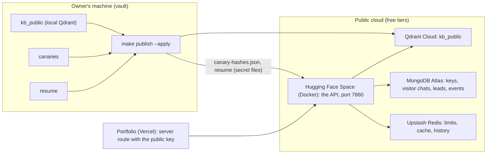

# Deploying the public assistant

The public deployment serves published knowledge only, with no admin routes at all
(`DEPLOYMENT_PROFILE=public`). The vault stays on the owner's machine.



## Why a container host

Vercel's Python functions cannot hold this app: the embedding, reranking and redaction models exceed their
size limits. The same `Dockerfile` runs on Hugging Face Spaces, Fly, Render or Cloud Run. The portfolio itself
stays on Vercel and calls the API from its server route.

## On the public profile

| | Vault | Public |
|---|---|---|
| Admin routes | mounted | not mounted (404) |
| Qdrant collections | `kb_public`, `kb_private`, `kb_confidential` | `kb_public` only |
| Retrieval filter | checks `kb_documents` in MongoDB | trusts `kb_public` (only published chunks are there) |
| Canary hashes | read from `canaries` | read from `PUBLIC_CANARY_HASHES_PATH` (hashes only) |
| Resume | decrypted from the vault | `PUBLIC_RESUME_PATH` |

## One-time setup (owner)

1. **Accounts.** Create free accounts with MongoDB Atlas, Upstash Redis and Qdrant Cloud.
2. **Space.** Create a Hugging Face Space with the Docker SDK and push this repository (or a deploy branch) to
   it. Code and config only: `.dockerignore` keeps `vault/`, `.env` and `dev-notes/` out.
3. **Variables and secrets.** Set them in the Space settings (secrets for anything private):

   | Name | Value |
   |---|---|
   | `MONGODB_URI`, `MONGODB_DATABASE` | the Atlas cluster |
   | `REDIS_URL` | Upstash (`rediss://…`) |
   | `QDRANT_URL`, `QDRANT_API_KEY` | Qdrant Cloud |
   | `VISITOR_HASH_SALT` | a new random value (not the vault's) |
   | `PUBLIC_OWNER_NAME` | your name, for the persona voice |
   | Provider keys | public-tier models only: `GEMINI_API_KEY`, `GROQ_API_KEY`, … |
   | `PUBLIC_CANARY_HASHES_PATH`, `PUBLIC_RESUME_PATH` | the secret files from `make publish` |
   | `TURNSTILE_SECRET_KEY`, SMTP settings | lead capture and alerts, as in the vault |

4. **Public key.** Make a key for the portfolio: `make keys ARGS="create portfolio --scope public:read"` against
   the Atlas database (set `MONGODB_URI` for that one command). Put the key in the portfolio's server
   environment.

## Every publish

```bash
make publish                 # dry run: counts only
make publish ARGS="--apply"  # mirror kb_public, prune, write vault/publish/*
```

`PUBLISH_QDRANT_URL` and `PUBLISH_QDRANT_API_KEY` in the vault's `.env` point at Qdrant Cloud. After an apply:
- upload `vault/publish/canary-hashes.json` and the resume as the Space's secret files when they changed;
- the canary file is re-read whenever its modification time changes, so no restart is needed.

## Smoke test

- `GET /healthz` returns 200, and `GET /readyz` returns 200 once MongoDB, Redis and Qdrant answer.
- `GET /admin/v1/whoami` returns 404 (no admin surface).
- With the portfolio key, `POST /v1/chat` answers about a published document with `[n]` citations.
- `make eval` against the vault checks the same pipeline before you publish.

## Rollback

Redeploy the Space's previous commit. To withdraw content: unpublish it in the vault, then
`make publish ARGS="--apply"`, which removes it from Qdrant Cloud.
