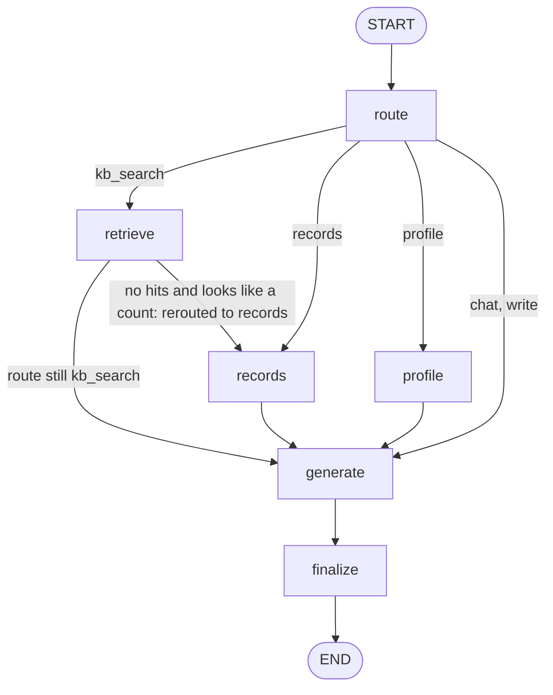
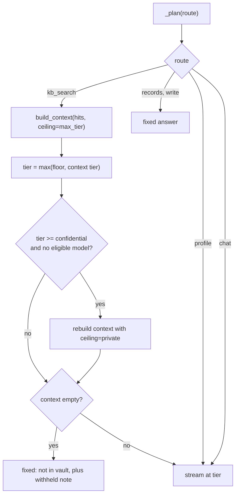
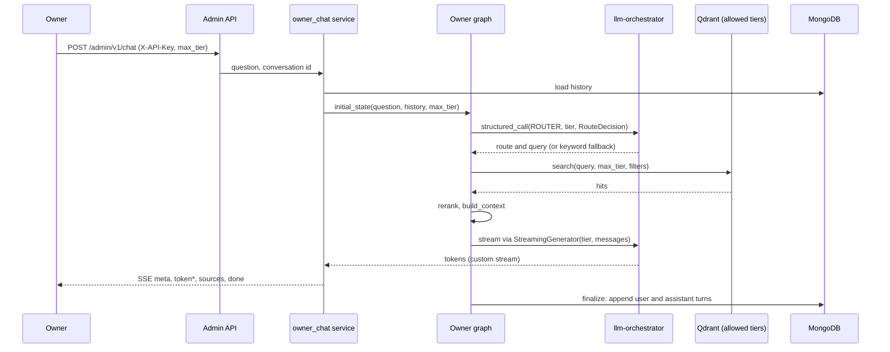
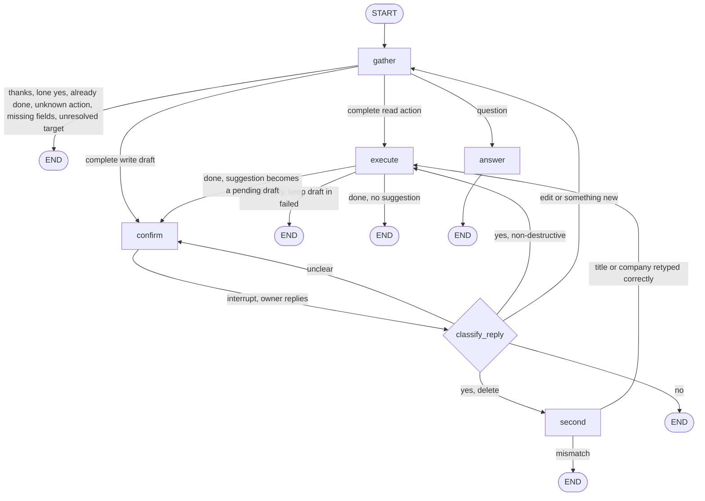
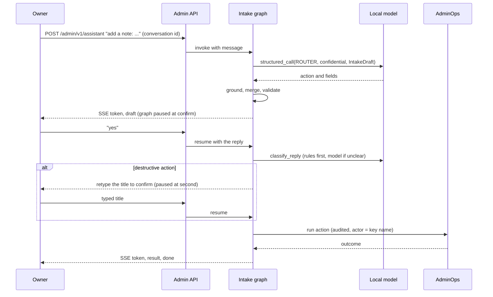

# Owner flow

Two graphs serve the owner: the **owner graph** (questions) and the **intake graph** (the assistant that adds
and changes data after confirmation, and hands questions to the owner graph). Derived from `build_owner_graph`
in `app/agents/graphs/owner.py` and `build_intake_graph` in `app/agents/graphs/intake.py`. Services:
`app/services/owner_chat.py` and `app/services/intake.py`. Admin routes exist only with
`DEPLOYMENT_PROFILE=vault`.

## Owner graph

| Function | Rule |
|---|---|
| `_after_route` | `kb_search` → `retrieve`, `records` → `records`, `profile` → `profile`, anything else (`chat`, `write`) → `generate` |
| `_after_retrieve` | `route == "records"` (set by the empty-hits fallback) → `records`, else `generate` |

| Node | What it does |
|---|---|
| `route` | Rule check for write requests (no model call; the answer is always a pointer to the intake assistant). Otherwise a `Role.ROUTER` `structured_call` fills `RouteDecision` (route, rewritten query, optional records query). A model decision passes `guard_records`; if no router model answers, `heuristic_route` decides from keywords. The call tier is the highest of the owner's floor and the tiers of history turns the call may read |
| `retrieve` | Hybrid search at the caller's `max_tier` with optional filters, then rerank. No hits plus a counting question tries the records tool once |
| `records` | Runs the structured-records query, only when `max_tier >= private` |
| `profile` | Loads profile facts, only when `max_tier >= private` |
| `generate` | `_plan` decides a fixed answer or a model call, then streams tokens through LangGraph's custom stream writer |
| `finalize` | Stores both turns (user and assistant, with route, tier, model, tokens, citations, `incomplete`, `withheld`) |

### Overviews and follow-ups (`retrieve`)

- **Broad mode:** an overview question ("summary of my projects", "list all my achievements") searches document
  cards first. It then adds the best chunks, takes up to 12 of each, and uses a 6,000-token budget.
- **Vague follow-ups:** a follow-up that names no topic of its own ("give me the summary", "tell me more")
  searches only the documents the previous answer cited.
- **Prompt `owner-v3`:** asks for a synthesised answer in the model's own words, with one paragraph per
  document for overviews. It never pastes the context back.
- **Models:** the generator model comes from `config/agents.yaml` (`owner`) unless the request names one.

### Tier handling inside `generate`

The tier of the model call is not the caller's `max_tier`; it is the highest tier actually present in the prompt:
the floor (`private`, or lower if the caller capped it, or higher with `min_tier`, or the conversation's own tier
when a model may read it, so a follow-up to a confidential answer still sees that answer), the visible history,
and the context chunks included. If that tier is `confidential` and no model may serve it, the context is rebuilt with a
`private` ceiling and the withheld count is told to the owner. Fixed answers (records summary, write redirect,
"not in your vault") need no model.

### Request sequence

Events, in order: `meta` (after routing), `token`*, `sources`, `done`. A failure ends with `error`. A model that
fails before its first token is skipped for the next eligible one; after the first token the partial answer is
kept and the turn is marked `incomplete`.

## Intake graph

The intake assistant runs two agents in sequence inside one graph: `gather` (the intake agent, which has a
local model extract an action and field values) and `execute` (the executor, which calls `AdminOps`). Every
model call runs at tier `confidential`, so only local models are eligible. The graph is compiled with a MongoDB
checkpointer; a pending draft is keyed by conversation id, so a confirmation survives an API restart and a
cache flush.

The `Command(goto=...)` returns in each node are the edges; `START → gather` and `answer → END` are the only
static ones.

| Node | What it does |
|---|---|
| `gather` | Settles trivial messages without a model. Otherwise `_extract` runs a `Role.ROUTER` `structured_call` into `IntakeDraft` (two attempts, because a small model sometimes stops mid-JSON). If the model fails, keyword `rule_action` may still name the action. Code then grounds the extracted values in the owner's own words, merges them into the draft, normalises, resolves targets (ids, recent items) and decides what is missing |
| `confirm` | `interrupt(...)` with the summary; on resume the reply is classified as yes, no, edit or something else. Nothing before the `interrupt` may have side effects, because the node re-runs on resume |
| `second` | Second `interrupt` for destructive actions: the owner must retype the title or company |
| `execute` | Runs the action spec through `AdminOps` with an actor derived from the API key name; on `AppError` stores the failed action so "try again" retries it; on success may produce one deterministic suggestion that becomes a new pending draft needing its own yes |
| `answer` | Calls the compiled owner graph (checkpointer off) at `confidential` min tier, forwarding its custom stream, then returns its answer, citations and route |

### Confirmation sequence

Events, in order: `meta`, `token`, `result` after a write, `draft` when a summary waits for confirmation, then
`done`; `error` replaces `done` on failure.

### Safety properties

- Writes never happen without an explicit yes; deletes need a second, typed confirmation.
- A model's output is only a proposal: values must be grounded in the owner's message, ids typed by the owner
  override the model's, and validation lives in code.
- Local models only: every intake call is `confidential`, so nothing from this path goes to a cloud API.
- Log lines carry step names, action names, field names and counts, never the owner's text or field values.
