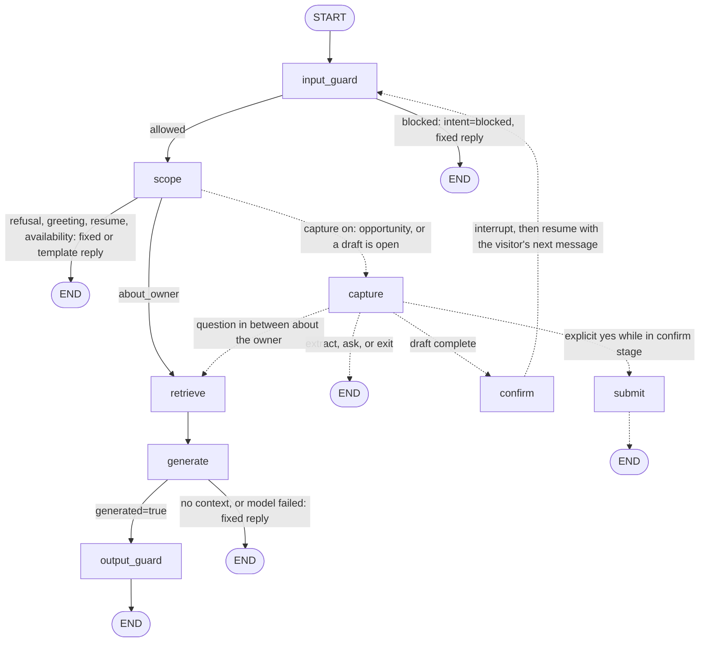
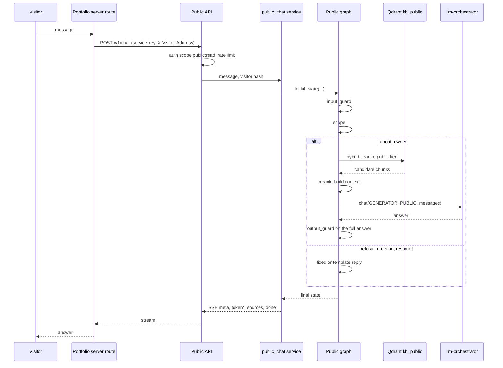
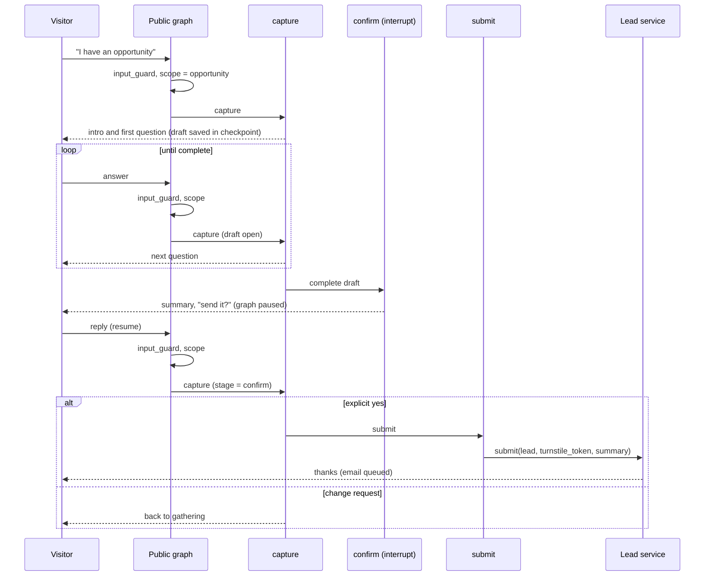

# Public flow

A visitor message through `POST /v1/chat`. Derived from `build_public_graph` in
`app/agents/graphs/public.py` and the capture nodes in `app/leads/capture.py`; the service wrapper is
`app/services/public_chat.py`.

Isolation is in code: the retriever is built with `kb_public` as its only collection and every search runs at
`Tier.PUBLIC` with no filters. Nothing in the state, the request or a prompt can name a tier or a collection.

## Graph

Without lead capture configured, the graph has five nodes. With it (`PublicDeps.capture`), three more
(`capture`, `confirm`, `submit`) are added and the graph needs a checkpointer, because the opportunity draft
lives in the thread's state (`public:<conversation id>`) between turns.

Dashed edges exist only when capture is configured. Each node logs one `public step` line with counts, intent,
rule names and latency; no visitor text, context or answer is logged.

### Routing functions

| Function | Rule |
|---|---|
| `_after_input` | `intent == "blocked"` → END, else `scope` |
| `_after_scope` (capture off) | `about_owner` → `retrieve`, else END |
| `_after_scope_capture` (capture on) | a draft is open or intent is `opportunity` → `capture`; otherwise as `_after_scope` |
| `_after_generate` | `generated` → `output_guard`, else END |

### Nodes

| Node | What it does | Failure behaviour |
|---|---|---|
| `input_guard` | Length cap, normalisation, heuristic rules, Prompt Guard 2 score, optional Jev second opinion | Block writes an `input_blocked` security event and the fixed `BLOCKED_REPLY`; a guard-model outage is noted and the message continues |
| `scope` | Rules, then `FlaggedClassifier` at public tier, then keyword fallbacks. Fixed replies for `meta_probe`, `out_of_scope`, `action_request`, `opportunity`, `greeting`; profile templates for `resume` and `availability` | `meta_probe` records a low-severity event |
| `retrieve` | Hybrid search at `Tier.PUBLIC` over `kb_public`, then cross-encoder rerank to `top_k` | none; an empty result leads to the no-context reply |
| `generate` | Builds a tier-capped context, then one `Role.GENERATOR` call at public tier with up to 4 answered `about_owner` turns of history | Empty context → `NO_CONTEXT`; `OrchestratorError` → `UNAVAILABLE`; both skip the output guard because nothing was generated |
| `output_guard` | Canary, identifier, disclosure, grounding checks on the whole answer | A failed check replaces the answer with `NO_CONTEXT`, clears sources, and writes `canary_hit` (critical) or `output_blocked` |
| `capture` | Extracts opportunity fields; see below | Turn cap → fixed contact-form reply |
| `confirm` | `interrupt`; the visitor's reply returns to `input_guard` | none |
| `submit` | Stores the lead and queues the email | Failure, missing Turnstile verification or caps produce fixed replies |

Refusals end at `scope`: no retrieval, no generation. Because a generated answer is complete when it reaches
`output_guard`, nothing a visitor sees has skipped it.

## Delivery sequence

Delivery is buffered. The graph finishes, the output guard has passed (or replaced) the whole answer, and only
then do `token` events go out.

Events, in order: `meta` (conversation id and intent), `token`*, `sources`, `done`. An unexpected failure ends
with `error`. Both turns are stored after the answer is decided, with the intent and guard verdicts (rule names
only) on the assistant turn. An answer cache short-circuits repeat questions and is invalidated when
publishing or unpublishing changes `kb_public`.

## Opportunity capture

The model only extracts. Email and link come from patterns in code, any model-provided value must be grounded in
the visitor's own words, and `app.leads.models.check` decides what is valid and what is missing. One short
question per turn, at most `LEAD_MAX_TURNS`, then the contact-form reply. Replies are fixed templates around the
visitor's own values: no generated text reaches the visitor from the capture nodes.

A question about the owner in the middle of capture is answered through `retrieve` as usual and the draft waits.
Nothing is stored or emailed before an explicit yes, and the Turnstile token is checked on submit only. The
optional summary for the owner passes the output guard or the email goes without it.
