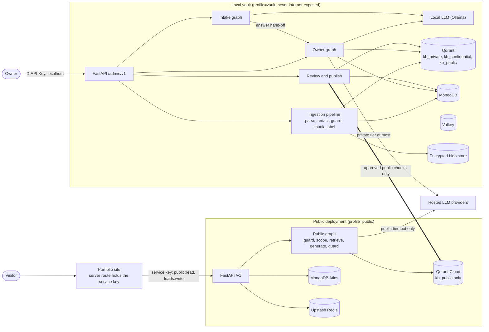
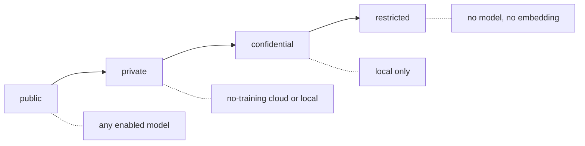
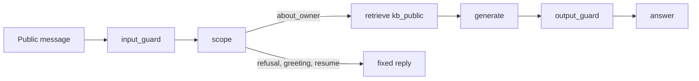

# High-level design: ai-twin

## Purpose

One service, two audiences:

1. **Owner mode.** The owner ingests everything about their career (notes, documents, links, repositories)
   and asks questions across every data tier.
2. **Public mode.** An assistant embedded in the owner's portfolio. It answers only from approved public
   facts, serves the resume and forwards opportunities by email.

Everything runs on free tiers or open-source software.

## Principles

- **Isolation by data, not by prompt.** The public path never holds private data, so no prompt can leak it.
- **Default deny.** New content is `private` until the owner approves it for publication.
- **Tier-aware models.** The data tier of a request decides which models may see it.
- **Every decision is observable.** Each request has one request id and one trace id across logs and traces.
- **Portable vault.** The whole local stack moves between machines (macOS with podman, Windows with docker) as
  one encrypted archive.

## Topology

One codebase, two deployment profiles (`DEPLOYMENT_PROFILE`): `vault` mounts the admin routes and runs on the
owner's machine; `public` mounts only `/v1/...` and health, and runs in the cloud.

Owner traffic never reaches the cloud, and the cloud never holds anything above `public`. The only arrow from
the vault to the cloud is publish. See [`threat-model.md`](threat-model.md) for the boundaries and
[`components.md`](components.md) for what each box is made of.

## Data tiers

Tiers are ordered `public < private < confidential < restricted`; policy is one integer comparison
(`request.tier <= model.max_tier`).

| Tier | Typical content | Stored | Qdrant collection | Models allowed |
|---|---|---|---|---|
| public | resume content, published projects, certification names, education summary, public links | vault + cloud | `kb_public` (copy made by publish) | any enabled model |
| private | interview notes, question bank, applications, work notes | vault | `kb_private` | no-training cloud models or local |
| confidential | compensation summary, offers | vault | `kb_confidential` | local model only |
| restricted | government ids, account numbers, dates of birth | encrypted raw file only; text never read | none (never embedded) | none |

The unpublished copy of a public document stays in `kb_private`; `kb_public` only ever receives copies made by
publishing.

## Components at a glance

| Component | Responsibility |
|---|---|
| `packages/llm-orchestrator` | Model inventory, role-based selection, tier policy, retries, fallbacks, structured output. No dependency on the app. |
| `app/kb/ingestion` | Parse, redact, employer guard, chunk, label, review queue. |
| `app/kb/retrieval` | Hybrid dense + sparse search, rerank, budgeted context. |
| `app/kb/publishing.py` | Approve, publish, unpublish, relabel. The only writer of `kb_public`. |
| `app/agents` | LangGraph graphs: `public`, `owner`, `intake`. |
| `app/guardrails` | Input guard, scope router, output guard, identifier recognisers, canary hashes. |
| `app/leads` | Opportunity capture, triage, outbox, email, Turnstile. |
| `app/security` | Security events, debounced email alerts. |
| `app/observability` | Langfuse tracing and masking, metrics. |
| `app/services` | Chat services, conversations, memory, profile, resume, rate limits, answer cache. |

Details and the LangChain boundary are in [`components.md`](components.md).

## Request flows

- Public chat: [`flows/public-flow.md`](flows/public-flow.md).
- Owner chat and the intake assistant: [`flows/owner-flow.md`](flows/owner-flow.md).
- Ingestion, publish and retrieval: [`rag-pipeline.md`](rag-pipeline.md).

## Storage

- **MongoDB:** sources, documents, chunk metadata, labels, audit, leads, structured records, profile facts,
  model overrides, conversations and messages, LangGraph checkpoints (intake and lead capture).
- **Qdrant:** dense + sparse vectors, one collection per tier group.
- **Redis/Valkey:** conversation turn cache, rate limits, alert debounce, answer cache.
- **Blob store:** encrypted raw files (vault only).

## Request identity and errors

Every HTTP request gets one `X-Request-ID` (a caller's value is kept only if it is short and printable,
otherwise a fresh id is made) and one OpenTelemetry trace id, returned as `X-Trace-ID`. Both are on every log
line. Every failure is rendered as one envelope: `{"error": {"code", "message", "request_id", "details"}}`,
with a closed set of codes (`app/exceptions/codes.py`).

## Observability

structlog with coloured console output in development and JSON in production. OpenTelemetry spans for requests.
Langfuse traces for agent runs: the Langfuse trace id is the request's trace id, LLM calls are generations, and
content is masked per channel (owner content never leaves the machine unless explicitly allowed on a
self-hosted Langfuse). Security events trigger debounced email alerts. Prometheus-style metrics count guard
decisions, scope intents and model attempts.

## Delivery

Spec-driven. Each feature branch from `develop` starts with `specs/<feature>/{spec,plan,tasks}.md`. Each task is
one commit, and the full check runs once before the PR. `develop` is merged to `main` after end-to-end
verification.
