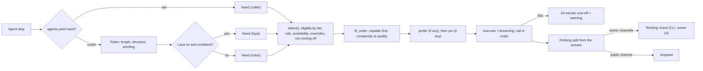

# LLM gateway

Model choice in auto mode: each request is fitted to a model by what it needs (how complex it is, whether it
needs tools or step-by-step reasoning) instead of walking one fixed chain. Policy still comes first: the
gateway only reorders models that the tier rule, availability and overrides already allow.

Code:
- `packages/llm-orchestrator/src/llm_orchestrator/gateway.py`: `Need`, `Profiler`, `fit_order`
- `selection.py`
- `thinking.py`
- `cooloff.py`
- `scripts/models_check.py`

Config: `config/models.yaml` (`capabilities`, `quality`) and `config/agents.yaml` (`need`).

## Flow

## What a model declares

| Field | Meaning |
|---|---|
| `capabilities` | `text` (always), `tools`, `reasoning` |
| `quality` | 1–5, a rough strength rank. Shipped: gpt-oss-120b and Claude 5; Gemini Flash 4; `qwen2.5:14b` 4; Cerebras Qwen 3; `qwen2.5:7b` 3; Groq Llama 8B and Gemini Lite 2; `llama3.2:3b` 1 |

These are declared, not probed. Tune them in `config/models.yaml`.

## What a request needs

| Need | How it is set |
|---|---|
| `complexity` | `config/agents.yaml` `need` (prep: complex, intake: moderate), else the profiler |
| `reasoning` | true for complex needs and for wording such as "step by step", "diagnose", "compare", "design" |
| `tools` | set by a caller that will pass tools (no agent does yet) |

**Fit order:**
- Models that have the needed capabilities come first.
- **Complex:** the strongest first.
- **Simple and moderate:** the quality nearest at or above the target (2 or 3) first, then cheaper models.
- Every eligible model stays as a fallback, so an unreachable provider never leaves a request without a model.
- Confidential needs still get local models only.

## Thinking

| Where | What happens |
|---|---|
| Ollama models with `reasoning` | Run with the client's `reasoning=True`; thinking arrives separately |
| Any other model | `<think>…</think>` is cut out of the reply (whole or streamed) |
| Owner chat, prep, super agent | Streamed as a `thinking` SSE event. The CLI shows it dimmed above the answer (`/thinking` toggles it). An owner-mode UI can render the same event |
| Public chat | Never forwarded |
| Logs, stored turns | Never; logs carry only the size |

## Retired model ids

- **`make models-check`** (Windows: `./scripts/dev.ps1 models-check`) lists each enabled cloud model as `ok`,
  `missing`, `no key` or `unreachable`. It exits 1 when an id is missing. `make doctor` shows the same result
  in one line. Keys go in request headers only and are never printed.
- **At runtime,** a 404 puts the model on a 10-minute cool-off: selection skips it and a warning names the id
  to update. After the cool-off it is tried again, so a pulled Ollama model or a fixed id is picked up on its
  own.

## Observability

| Log line | Fields |
|---|---|
| `gateway` | role, tier, need (`complex+reasoning`), source (`caller`, `rules`, `laya`), prefer, first three models |
| `thinking separated` | model, size in characters |
| `model not found; skipped for a while` | model, provider, provider model id, seconds, how to fix |
