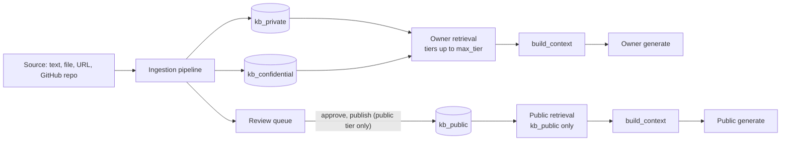
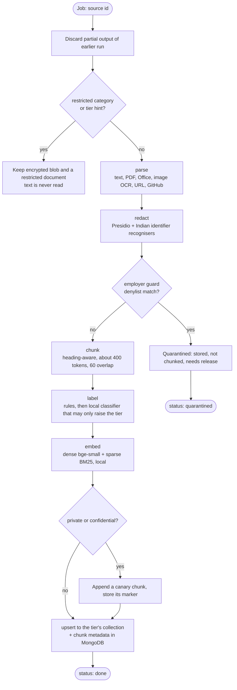
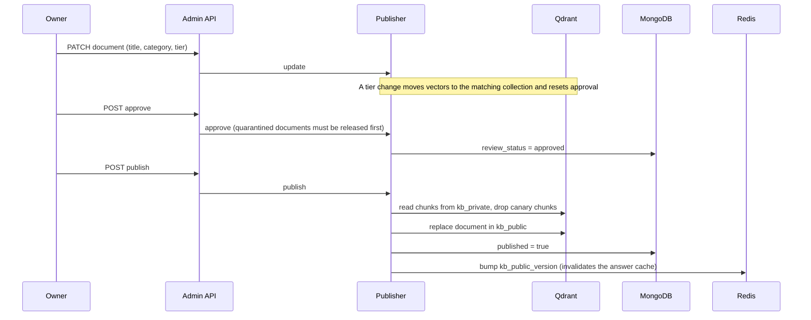
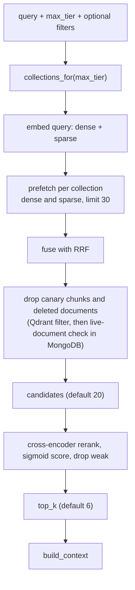

# RAG pipeline

How knowledge gets in, reaches the public collection and comes back out. Sources: `app/kb/ingestion/pipeline.py`,
`app/kb/publishing.py`, `app/kb/retrieval/`, `app/kb/vectors.py`. Callers are the owner and public graphs
([owner flow](flows/owner-flow.md), [public flow](flows/public-flow.md)).

## Overview

Mongo holds sources, documents, chunk metadata and review state; Qdrant holds dense and sparse vectors with a
payload per chunk; the encrypted blob store keeps raw files.

## Ingestion

One source in, reviewed-pending documents and vectors out. Jobs run in an in-process worker pool; job state
lives on the `Source` document, so a restart re-queues unfinished jobs (up to three runs, then failed). Each run
first removes what an interrupted earlier run left, so a re-queued job finishes exactly once.

| Stage | Notes |
|---|---|
| Parse | Parsers per type; images through local OCR; URLs and GitHub repos are fetched by the pipeline |
| Redact | Runs before everything that reads text, so the guard, chunks, labels, models, logs and vectors only ever see placeholders such as `[AADHAAR]`. Published contact details are allowlisted, and so is a person name made only of the owner's own name parts (`OWNER_NAMES`). Reports hold counts, never values |
| Employer guard | Owner denylist in the git-ignored vault; only rule names are stored or logged |
| Chunk | Heading path is repeated at the top of every chunk so a chunk read alone still says what it is about |
| Label | Rules (category, source), redaction results (identifiers found → at least `private`), then the `classifier` role at tier `confidential`, so only local models are eligible. Final tier = max(rules, classifier). With no eligible model the rule label stands |
| Embed | `BAAI/bge-small-en-v1.5` dense (384) and `Qdrant/bm25` sparse, local via fastembed; nothing is sent to a cloud embedder |
| Tag | A document ingested without tags gets 3–6 from one short `classifier`-role call at its own tier (quarantined and restricted ones never) |
| Index | New and relabelled documents go to the collection of their tier (`public` and `private` documents both land in `kb_private` until published) |
| Card | A ≤ 800-character summary written by a generator allowed at the document's tier, stored on the document (`card`) and indexed as one extra point with `card: true`. The offline mock never writes cards. `POST /admin/v1/documents/cards` (`make kb-sync ARGS="cards --apply"`) backfills older documents |

- **Source-implied tier:** a private GitHub repository sets a private hint, so it is never labelled public.
- **Refresh:** `refresh: true` on URL and GitHub ingest re-runs a finished source. The job removes the documents
  and vectors the last run made, then ingests afresh. `make kb-sync` uses it when a manifest entry changes.

## Review and publish

New content is `private` until the owner approves publishing. Only `public`-tier documents can be published.

`unpublish` removes the document from `kb_public`, flags the private copy unpublished and bumps the same
version. The private copies always stay for owner retrieval.

**Local-only release.** `POST /documents/{id}/release` with `localOnly: true` (the default, and what the intake
`release` action uses) indexes a quarantined document at `confidential`, so only local models read it. It sets
`localOnly`: publish is refused for good, and the tier cannot be lowered below confidential. `localOnly: false`
releases at the tier the labels give.

## Retrieval

| Property | How it is enforced |
|---|---|
| Tier isolation | `max_tier` decides which collections are queried at all, so a public caller cannot reach private vectors through a filter mistake. The public retriever is constructed with `kb_public` only (`PUBLIC_COLLECTIONS`) |
| No restricted text | Restricted documents are never embedded, so no collection holds them |
| Canary safety | Canary chunks are excluded in the Qdrant filter and again on the way out |
| Freshness | Deleted documents are dropped by a live-document check |

`search` also takes `cards_only` (document cards only) and `document_ids` (search inside those documents).

## Context building

`build_context(hits, budget_tokens, ceiling)` turns ranked hits into what a generator sees:

- Chunks above `ceiling` are withheld and counted (never silently dropped); the owner is told how many.
- Citations are numbered per document in order of first appearance, so two chunks of one note share a number.
- The context stays within a token budget (public default 1500, owner default 3000).
- The context's tier is the highest tier among the chunks actually included. The owner graph uses it to pick the
  call's tier; the public graph passes `Tier.PUBLIC` as both ceiling and call tier.

## Defaults

| Setting | Default | Setting name |
|---|---|---|
| Chunk size / overlap | 400 / 60 tokens | `chunk_target_tokens`, `chunk_overlap_tokens` |
| Prefetch per branch | 30 | `retrieval_prefetch` |
| Final hits | 6 | `retrieval_top_k` |
| Rerank minimum score | 0.01 | `rerank_min_score` |
| Owner / public context budget | 3000 / 1500 tokens | `owner_context_tokens`, `public_context_tokens` |
