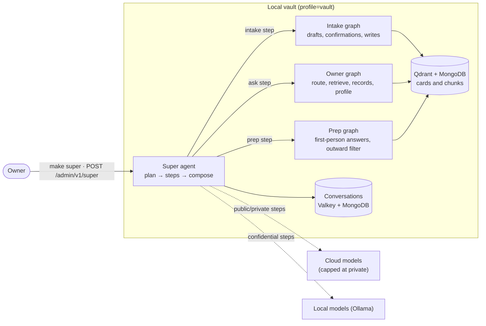
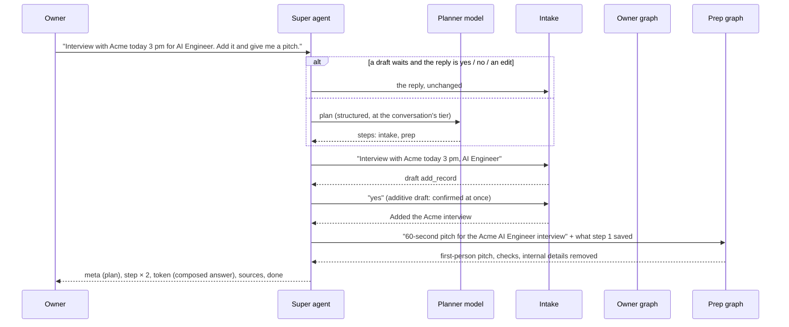

# Super agent

One local-only conversation for everything the owner does with the vault:
- save notes and job-search records;
- ask questions across every tier;
- prepare interview and application answers.

The super agent never answers itself. It plans each message into steps and hands every step to the agent built
for it, so each agent's guards still apply. It runs only in the vault profile (`DEPLOYMENT_PROFILE=vault`), on
the owner's machine.

- Code: `app/services/super_agent.py`; prompt `app/agents/prompts/super_agent.py` (`super-v1`).
- API: `POST /admin/v1/super` (SSE).
- CLI: `make super` (Windows: `./scripts/dev.ps1 super`).

## Where it sits

## A turn

### 1. Plan
- **The plan:** one structured call returns `SuperPlan` with 1–4 steps. Each step is `{agent, instruction}`, and
  `agent` is one of `intake`, `ask`, `prep` or `chat`.
- **The prompt:** it lists what each agent does. It asks for standalone instructions that copy every detail the
  owner gave (companies, times, roles, word limits) and invent none.
- **The tier:** the planner runs at the conversation's tier, the highest tier among the recent turns (at least
  private). After a confidential answer, a local model plans the follow-up.
- **No model:** if no model can plan, rules make a one-step plan (`rule_plan`):
  - writes and reports ("I applied", "scheduled", "add …") go to intake;
  - interview or application wording goes to prep;
  - everything else goes to ask.
- **A waiting draft:** if a draft is waiting and the message is a yes, no or edit (intake's own reply rules), it
  goes straight to intake, with no plan.

### 2. Steps

| Agent | How it runs | Stores turns |
|---|---|---|
| `intake` | `IntakeService` in a **linked intake conversation**; its id is kept on the super conversation's assistant turns (`guards.intake_conversation`). | in the linked intake conversation |
| `ask` | The owner graph with `persist=False`, the super conversation's history, `max_tier` confidential. | no |
| `prep` | The prep graph with `persist=False`; its outward-safety filter and checks always run. | no |
| `chat` | A fixed reply. | no |

- **Intake drafts:**
  - Confirmed at once, because they only add or update: `add_note`, `ingest_*`, `add_record(s)`,
    `update_record`, `update_profile`, `remember`, `approve`, `release`, and the read-only actions.
  - Wait for the owner (the turn ends with `pending: true`): deletes, `publish`, `unpublish`,
    `approve_publish`, `relabel` (a tier change), `forget`, and every retype check.
- **Chaining:** a later step sees what earlier steps produced, appended to its instruction ("Earlier in this
  request: …"). For example, "add it, then prep me for it".

### 3. Compose and store
- **The answer:** one step's text is the answer. Several are joined under short headings: **Saved**, **From your
  vault**, **Your answer**.
- **Sources:** the union of every step's sources, keeping each step's citation numbers.
- **Storage:** one user turn and one assistant turn go into the super conversation (`mode: super`), routed
  `super:<agents>`, with the highest step tier and every step's model. That conversation lists, continues,
  summarises and re-titles like the others.

## Models

`config/agents.yaml` sets each agent's choice; the super agent's choice is also passed down to its `ask` and
`prep` steps.

| Key | Meaning |
|---|---|
| `model` | `auto`, or an inventory id pinned whenever its `max_tier` allows the step's tier |
| `prefer` | auto-mode ordering: `fast`, `quality`, `paid`, `local`, `local-quality`, `local-max` |
| `confidential_model` | `auto`, or a **local** id (loading refuses a cloud id) |
| `confidential_prefer` | as `prefer`, for confidential steps |

- **Order:** a request's own `model` wins, then the agent's pin, then auto.
- **The cap:** the tier rule is checked last and always holds. Cloud providers (Groq, Cerebras, Gemini,
  OpenRouter, Anthropic, OpenAI) are capped at `private` when the inventory loads, so no setting can send
  confidential text to them.
- **Shipped settings:** `super: {prefer: quality, confidential_prefer: local-max}`.
  - Private steps go to the best available cloud model (Groq `gpt-oss-120b` first, or a paid model with
    `prefer: paid`).
  - Confidential steps go to `ollama-qwen-14b` (`qwen2.5:14b`) when it is pulled, then `qwen2.5:7b`, then
    `llama3.2:3b`.

### Recommended local models
- **Mac M4 Pro, 24 GB:** `qwen2.5:14b` (about 9 GB) for the super agent and `qwen2.5:7b` for everything else.
  Both fit beside the stack.
- **Windows laptop:** `qwen2.5:7b`. Without a GPU, keep `qwen2.5:14b` off the chain (don't pull it).
- **Qwen3 (`qwen3:8b`, `qwen3:14b`):** adds tool calling and a thinking mode. It needs the planned LLM gateway
  to strip `<think>` blocks before it is used for answers.

## Events

| Event | Data |
|---|---|
| `meta` | `conversationId`, `mode: super`, `plan` (steps), `planSource` (`model:<id>`, `rules` or `reply`) |
| `step` | `index`, `agent`, `status` (`running`, then `done`, `pending` or `error`), `model`, `tier`, `action` |
| `token` | the composed answer, in one piece (prep text is filtered before it is sent) |
| `sources` | cited documents |
| `done` | `tier`, `steps`, `pending`, `models`, `latencyMs`, `seq` |
| `error` | `code`, `message`, `incomplete` |

## Safety
- **On the machine:** the super agent and every agent it calls run in the vault process. Traffic leaves the
  machine only for a model call that its tier allows.
- **Writes:** additions and updates are applied without asking (the owner chose this). Deletes, publishing and
  tier changes always wait for a yes, and every write is audited by intake as before.
- **Outward text:** prep answers are meant to be sent to other companies, so internal identifiers are removed in
  code before they are shown.
- **Logs:** they carry agents, counts, tiers and models only. Langfuse masks owner content as for the other
  owner channels.
