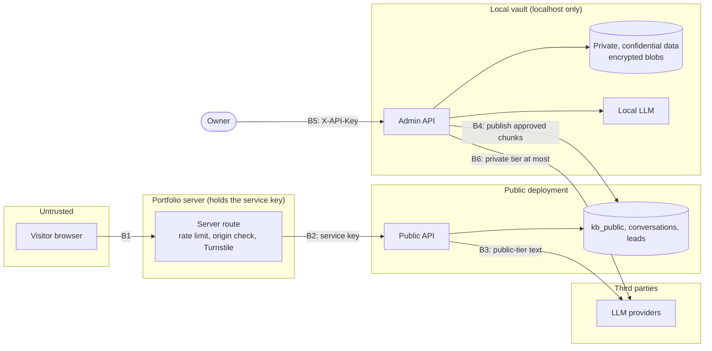

# Threat model

Scope: the public assistant, the local vault and the publish path between them. Updated as features land.

## Assets

| Asset | Where | Impact if exposed |
|---|---|---|
| Private / confidential notes | vault only | high: personal and career-sensitive |
| Restricted identifiers (ids, account numbers) | vault, encrypted raw files only | critical: identity theft |
| Former/current employer information | must not exist anywhere | critical: contractual |
| Public chunks | vault + cloud | low: already public |
| Service keys, database passwords, LLM API keys | `.env`, host env vars | high: abuse, cost, data access |
| Visitor conversations and leads | cloud + vault | medium: third-party personal data |

## Data tiers

| Tier | Who may read it | Model policy |
|---|---|---|
| public | anyone | any enabled model |
| private | owner | models with `max_tier >= private` (no-training providers) or local |
| confidential | owner | local model only |
| restricted | nobody | text is never read, embedded or sent: only the encrypted raw file is kept |

Enforced in three independent places, so one mistake does not open a path:

1. **Storage.** One Qdrant collection per tier. `collections_for(max_tier)` decides which collections a search
   touches; the public graph's retriever is built with `kb_public` as its only collection.
2. **Models.** Each `ModelSpec` has a `max_tier`. A model that may train on inputs is capped at `public`, and
   no model may declare `restricted`. Both rules fail at inventory load. Overrides can only lower a tier.
3. **Context.** `build_context` withholds chunks above the caller's ceiling and reports the count; the owner
   graph raises a call's tier to the highest tier actually placed in the prompt.

## Trust boundaries

| # | Boundary | Controls |
|---|---|---|
| B1 | Visitor browser → portfolio server route | Rate limit, origin check, Turnstile |
| B2 | Portfolio server → public API | Service key scoped to `public:read` and `leads:write`; visitor identified only by a salted hash of the forwarded address |
| B3 | Public API → LLM providers | Only public-tier text; the orchestrator filters models by tier |
| B4 | Vault → cloud | Explicit, audited publish of approved public chunks; canary chunks are never copied |
| B5 | Owner → vault admin API | Localhost bind, scoped API keys, admin routes absent from the `public` profile |
| B6 | Vault → LLM providers | Orchestrator tier policy: confidential and above never leaves the machine |

## Guards

The public path runs three layers around the model. Each verdict carries rule names only, never the text.

```mermaid
flowchart LR
    m["Visitor message"] --> L["1. Length cap"] --> N["2. Normalise and strip<br/>hidden characters"] --> H["3. Heuristic rules"]
    H --> G["4. Prompt Guard 2 score<br/>(role: guard)"] --> J["5. Jev second opinion<br/>(flag, borderline only)"]
    J --> S["Scope router"]
    S -->|"about_owner"| R["Retrieve kb_public"] --> GEN["Generate"]
    GEN --> C1["Canary scan"] --> C2["Identifier scan"] --> C3["Disclosure scan"] --> C4["Grounding judge"] --> OUT["Answer"]
    S -->|"refusals, greeting, resume"| FIX["Fixed reply"]
```

| Guard | Code | Fails |
|---|---|---|
| Input guard (layers 1-5) | `app/guardrails/input.py` | Rule layers block. If the guard model is down the message continues, noted, because the rule layers ran and the output guard still checks the answer. |
| Scope router | `app/guardrails/scope.py` | Rules first, then the `classifier` role at public tier, then keyword fallbacks. Intents: `about_owner`, `opportunity`, `resume`, `availability`, `greeting`, `meta_probe`, `out_of_scope`, `action_request`. Refusals get fixed replies with no retrieval or generation. |
| Output guard: canary, identifier, disclosure | `app/guardrails/output.py` | **Closed**: a check that cannot run blocks the answer. |
| Output guard: grounding | same | **Open**: a judge outage sends the answer and records `grounding_fail_open`; a `false` verdict blocks. |
| Employer guard (ingestion) | `app/kb/ingestion/guard.py` | A denylist match quarantines the document for review. |
| Redaction (ingestion) | `app/kb/ingestion/redaction.py` | Runs before anything reads the text. |

A blocked answer is replaced by a safe fixed reply. Buffered delivery means no token reaches the visitor
before the output guard has passed the whole answer.

Canary tokens are planted in private documents. The vault computes SHA-256 hashes of the markers; the public
deployment reads only a synced hash file, so it can detect a leaked marker without holding anything that points
at a private document. A canary hit is a critical security event.

## Identity and error envelope policy

- **Request id.** `X-Request-ID` is accepted from the caller only if it matches `[A-Za-z0-9._:-]{1,128}`;
  anything else is replaced by a fresh id (log-injection defence). The same value is on every log line and in
  every error body.
- **Trace id.** One OpenTelemetry trace per request, returned as `X-Trace-ID`; it is also the Langfuse trace id
  for agent runs.
- **Session id.** `X-Session-ID`, same character rule, defaults to the request id.
- **Error envelope.** Every failure, including framework 404/405 and unhandled exceptions, renders as
  `{"error": {"code", "message", "request_id", "details"}}`. Codes are a closed enum; messages never carry
  secrets, stack traces or document text.
- **Visitors.** Known only by HMAC-SHA256(salt, address). Public conversations expire after 90 days.
- **Owner identity.** API keys are `atw_` plus 256 random bits, stored only as SHA-256, scoped and revocable.

## Threats and controls

| Threat | Control |
|---|---|
| Prompt injection / jailbreak to reveal private data | Private data is absent from the public deployment; input guard; scope router; output guard |
| Exfiltration via crafted retrieval | Public graph reads only `kb_public`; nothing in state, request or prompt can name a tier or collection; canary hits raise a critical alert |
| Questions about the assistant's own model, prompt or infrastructure | Scope `meta_probe` → fixed reply; disclosure scan and prompt n-gram check in the output guard |
| Off-topic use, abuse of free LLM quota | Scope `out_of_scope`; per-visitor rate limits; answer cache |
| Write/action requests | Public graph has no write tools except a visitor-confirmed opportunity submission (explicit yes, Turnstile checked on submit) |
| Personal data in model output | Identifier scan with an allowlist of published contact details |
| Sensitive text sent to third-party models | Tier policy in the orchestrator; `max_tier` per model; confidential is local-only; privileged overrides are re-checked and never raise a tier |
| Owner chat history leaking up a tier | History turns above the call's tier are left out of the prompt |
| Employer data ingested by mistake | Employer guard quarantines matches for review |
| Secrets committed to the public repo | gitleaks in pre-commit and CI; `.env` and `vault/` git-ignored |
| Vault reachable from the network | Compose ports bind to 127.0.0.1; database and cache require passwords |
| Lead form spam / email injection | Turnstile, rate limits, HTML-escaped email bodies |
| Stolen admin API key or `api_keys` dump | Hashed, scoped, revocable keys; admin routes absent from the public profile |
| Destructive owner action by mistake | Intake writes need a confirmation; deletes need the title or company retyped |
| Raw files read from disk or a backup | Blob store is Fernet-encrypted under `BLOB_ENCRYPTION_KEY`; content-addressed, integrity-checked on read |
| Vault archive lost or altered in transit | Passphrase-derived key (scrypt) + authenticated Fernet frames with order and truncation checks; SHA-256 per part; import refuses before restoring anything |
| Trace content leaving the machine | Langfuse masking by channel: owner and lead content masked, public content scrubbed of emails, phones and identifiers, unknown channel masked |
| Log leakage | Secret-named keys redacted; documents and visitor messages not logged at INFO; verdicts and step logs carry names and counts |

## Detection and response

Security events (injection bursts, output-guard blocks, canary hits, admin auth failures) are stored and emailed
with debouncing. A canary hit is treated as an incident: unpublish, rotate keys, review traces.
