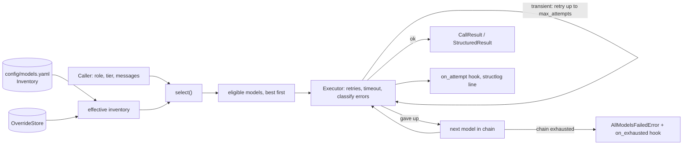

# llm-orchestrator

Picks a chat model per call from a role chain, filtered by data tier, then runs it with retries and
fallbacks. It has no dependency on the ai-twin app. See `specs/llm-orchestrator/spec.md`.

Tiers are ordered `public < private < confidential < restricted`. A model serves a request only when
`request.tier <= model.max_tier`, and no model may declare `restricted`.

Where it sits in the system: [`docs/components.md`](../../docs/components.md#langchain-and-langgraph-in-this-project).

## Call path



## Public API

```python
from llm_orchestrator import (
    Orchestrator,
    OrchestratorSettings,
    Inventory,
    ProviderSecrets,
    Role,
    Tier,
)

orch = Orchestrator(
    Inventory.from_yaml(path), OrchestratorSettings(secrets=ProviderSecrets(...)), store
)
result = await orch.chat(Role.GENERATOR, Tier.PRIVATE, messages)  # CallResult
parsed = await orch.structured_call(
    Role.ROUTER, Tier.PRIVATE, Schema, messages
)  # StructuredResult[Schema]
spec = await orch.select(Role.GENERATOR, Tier.PRIVATE)  # who would answer
specs_and_models = await orch.chat_models(Role.GENERATOR, Tier.PRIVATE)  # for callers that stream
```

| Method | Returns | Use |
|---|---|---|
| `chat(role, tier, messages, ...)` | `CallResult(text, model_id, attempts, fallback_used, usage)` | One completion with full fallback |
| `structured_call(role, tier, schema, messages, ...)` | `StructuredResult(value, model_id, attempts, fallback_used)` | A validated pydantic object |
| `structured(...)` | the value only | Same without the metadata |
| `select(role, tier, ...)` | `Selection` (ordered specs) | Ask who would serve a call, e.g. to decide whether a tier is answerable |
| `chat_model_for(...)` / `chat_models(...)` | LangChain `BaseChatModel`(s) with specs | Callers that stream and own their fallback (the app's `StreamingGenerator`) |
| `model_counts()` | usable models per role at the public tier | Readiness reporting |

All of them accept `model`, `prefer`, `privileged`, plus `callbacks` and `max_tokens` where a call is made.

## Inventory

`config/models.yaml` is the committed default: model specs plus an ordered chain per role. Loading validates:

- unique ids; every chain id exists, serves that role and is not repeated;
- no model may serve `restricted`;
- a model with `trains_on_inputs: true` is capped at `public`.

A `ModelSpec` carries `provider`, `model`, `roles`, `max_tier`, `context_window`, `trains_on_inputs`,
`free_tier` and `cost` (documentation of provider limits; the orchestrator does not enforce quotas), `enabled`,
`tags` (ordering hints for `prefer`) and an optional `base_url`.

Current shape of the default inventory (see the file for exact ids and models):

| Provider | Roles | `max_tier` | Notes |
|---|---|---|---|
| Groq | router, classifier, generator, judge, guard | `private` (guard: `public`) | Inputs not retained for training; primary for every role. The guard is a small prompt-injection scorer |
| Cerebras | router, classifier, generator, judge | `private` | Inputs and outputs not retained; first fallback |
| Gemini free tier | router, classifier, generator, judge | `public` | Inputs may improve provider products, so public only |
| OpenRouter `:free` | router, classifier, generator, judge | `public` | Upstream may log or train |
| Ollama (local) | router, classifier, generator, judge | `confidential` | The only real model allowed confidential text |
| mock | router, classifier, generator, judge | `confidential` | Tests and keyless runs; only when `LLM_MOCK_ENABLED` |

Chains run no-training cloud providers first, then public-only free tiers, then the local model, then the mock.
For private and confidential requests the public-only entries are filtered out, so the chain collapses to the
eligible subset. A provider with no key (or no endpoint, for Ollama) is **disabled**, not an error.

## Roles

| Role | What it is for |
|---|---|
| `router` | Small structured decisions: owner route, intake action extraction, confirmation classification |
| `classifier` | Pick one label: scope intent, document tier proposal |
| `generator` | User-visible text and lead extraction |
| `judge` | Yes/no verdicts such as grounding |
| `guard` | Prompt-injection score for untrusted text; the reply is a 0..1 number, not prose. Single-model chain with no fallback; the caller keeps its rule layers when it is down |

## Tier policy (`max_tier`)

`policy.rejection()` returns the first reason a model cannot serve a call, in this order: `unknown_model`,
`disabled`, `not_configured` (no key), `wrong_role`, `under_tier` (`request.tier > max_tier`, or the request is
`restricted`). `select()` keeps only models with no rejection. If none remain it raises
`NoEligibleModelError`; callers treat that as "this tier cannot be answered here".

| Request tier | Eligible in the default inventory |
|---|---|
| public | every enabled and configured model |
| private | Groq and Cerebras no-training models, local |
| confidential | local only |
| restricted | none |

## Fallbacks and retries

- **Within one model** (`Executor.run`, tenacity): transient errors retry with jittered exponential backoff up to
  `max_attempts` (default 3). Transient: timeouts, connection errors, HTTP 408/409/425/429 and 5xx, and SDK
  exceptions whose class name says timeout, rate limit or unavailable. Anything else (other 4xx) is permanent and
  not retried. Provider SDK retries are switched off so every attempt is counted here.
- **Across models**: after a model gives up, the next eligible one in the role chain is tried. `fallback_used` is
  `True` when the answering model was not the first. When the chain is exhausted, `AllModelsFailedError` lists
  every attempt (model, number, outcome, status), without any prompt or completion text.
- **Streaming** is outside this package: `chat_models()` returns the eligible list and the app's streaming
  generator falls back only before the first token.

## Overrides

Two layers sit on top of the file. They can tighten, never widen:

| Layer | Who | Can do |
|---|---|---|
| `OverrideStore` (MongoDB-backed in the app; in-memory here) | Owner, through an audited admin route | Disable a model, **lower** its `max_tier`, reorder a role chain. Read on every call, so a change applies to the next call. A raised `max_tier` is refused on write and ignored (with a warning) if a store skipped validation; an invalid chain is ignored |
| Per-call `model=` / `prefer=` | Callers with `privileged=True` only | `model=` pins one model: it must pass the same policy or `OverrideRejectedError(reason)` is raised, and there is no fallback. `prefer="fast" \| "quality" \| "local"` stable-sorts models carrying that tag first |

An unprivileged caller's `model`/`prefer` is ignored and logged. The app marks owner-side calls privileged and
never public-side ones.

## Structured output (`structured_call`)

Does not rely on provider tool calling, so small and local models work.

1. A system message carries the JSON Schema of the pydantic model ("reply with a single JSON object").
2. The reply is parsed (code fences tolerated) and validated.
3. On invalid output the same model gets one repair message naming the problems; a second failure moves to the
   next model. Invalid attempts are marked `invalid_output` in `attempts`.
4. If every model fails, `AllModelsFailedError`.

## Budgets

| Budget | Where | Default |
|---|---|---|
| Attempts per model | `OrchestratorSettings.max_attempts` (`LLM_MAX_ATTEMPTS`) | 3 |
| Time per call | `timeout_seconds` (`LLM_TIMEOUT_SECONDS`), applied with `asyncio.timeout` and in the SDK client | 30 s |
| Time for local models | `local_timeout_seconds` (`LLM_LOCAL_TIMEOUT_SECONDS`), for models tagged `local` | 120 s in `.env.example` |
| Output length | `max_tokens=` on `chat` / `structured_call` (the input guard uses 16) | provider default |
| Context size | `ModelSpec.context_window` documents the limit; the app budgets context tokens itself (`build_context`) | n/a |
| Provider quotas | `free_tier` in the inventory is documentation only | not enforced |

## Classifiers and Jev

`llm_orchestrator.classify` offers one `Classifier` protocol (`classify(text, question, labels, tier)` returning a
label, normalised probabilities and a confidence) with three implementations:

- `LLMClassifier`: `structured_call` on the `classifier` role.
- `JevClassifier`: the TypeSafe Jev adapter, one `choice` question to `POST /v1/systemone` over httpx. **Public
  tier only** (`JEV_MAX_TIER`); a higher tier raises `NoEligibleModelError`. 429, 529, 408 and 5xx are transient
  (honouring `retry-after`, capped at 30 s); other 4xx are permanent. Neither text nor answer is logged.
- `FlaggedClassifier`: uses Jev when the feature flag (`FF_JEV_ENABLED`) is on, a Jev client exists and the tier is
  public; on any Jev failure it falls back to the LLM classifier. Private and confidential text never reaches Jev.

The flag may be a callable so it can be read at runtime on every call. The app uses it for the scope router, the
input guard's borderline second opinion and the grounding judge.

## Hooks

`llm_orchestrator.hooks` lets the host app observe the orchestrator without it importing the app:

| Hook | Fires | Payload |
|---|---|---|
| `on_attempt(listener)` | once per provider call | `AttemptEvent`: role, tier, model id, provider, attempt number, outcome, latency, token counts, error type |
| `on_exhausted(listener)` | when a chain is exhausted, just before `AllModelsFailedError` | role, tier, the attempts |

Listeners get names and numbers only, run inline, and must be quick. A listener that raises is logged and
skipped, never breaking a model call. Each registration returns a function that removes the listener. The app
uses them for metrics and an "all models failed" security event.

Every call also logs one structlog line, `llm attempt`, with role, tier, model, provider, outcome, latency and
tokens, never content. Calls pass `RunnableConfig` metadata (`llm_role`, `llm_tier`, `llm_model`,
`ls_model_name`) so a tracing callback such as Langfuse can label the generation.

## Errors

All derive from `OrchestratorError`: `InventoryError` (bad file or override), `NoEligibleModelError`,
`OverrideRejectedError` (with a `Rejection` reason), `AllModelsFailedError` (with the attempts), `ProviderError`
(already classified as transient or permanent). The app maps the first three to `MODEL_UNAVAILABLE`-style
envelopes or fixed replies; it never shows a provider message to a visitor.
